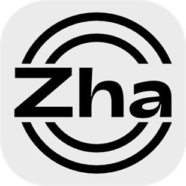

<p align="center">
  
</p>

<h1 align="center"><b>CapZha</b></h1>

<p align="center">
  基于 <a href="https://github.com/CapSoftware/Cap">Cap</a> 的中文增强版开源屏幕录制工具
  <br />
  <a href="https://github.com/zhadao/CapZha"><strong>GitHub 仓库 »</strong></a>
  <br />
  <b>支持平台：</b>Windows（macOS / Linux 未适配）
</p>

## 📖 项目简介

**CapZha** 是基于 [Cap](https://github.com/CapSoftware/Cap)（经 [Cap 中文版](https://github.com/lid664951-crypto/Cap) 汉化）改造的开源屏幕录制工具。当前版本 `v0.6.0`。

改造原则：**不改动任何录制/取屏核心管线**，只做体验增强、中文本地化与多屏适配。

## ✨ 特性

### 继承自 Cap / Cap 中文版
- **完全汉化**：界面与功能说明全部中文化
- **移除登录限制**：无需登录即可使用全部功能
- **三种录制模式**：屏幕录制 / 窗口录制 / 屏幕内自由框选区域
- **即时模式（快速录制）**：录完即得，支持 MP4

### CapZha 增强
- **即时模式 GIF/MP4 格式选择**：录制前一键切换，选择持久化；GIF 采用录后转码（ffmpeg 解码 + gifski 编码，12fps，单段上限 60 秒）
- **录完询问复制**：录制完成弹出「是否复制到剪贴板？」询问条，以文件形式（CF_HDROP）复制，可直接粘贴到聊天窗口、文档等任意位置
- **只读预览工作区**：类工作室布局的即时预览窗口，GIF/MP4 自适应渲染 + 复制/导出/打开文件夹
- **成品落盘到你自己的目录**：按 `年/月/日` 分层、`cap_日期_时间.格式` 命名；设置中可自定义目录与保留条数（默认 50，超出自动清理）
- **多屏幕模式（设置中可开）**：双屏/多屏环境下先点选目标屏幕，再在该屏内框选录制区域，避免跨屏识别歧义
- **多屏混合 DPI 修复**：针对 200% + 100% 混合缩放双屏，选区 overlay 出生即落在目标屏（PerMonitorV2 物理像素布局），框选即录即所得、无偏移无频闪
- **移除更新报错弹窗与推广信息**：删除赞助/反馈板块、收款码及个人联系方式等外链，移除无效的更新检查报错

## 📸 界面预览

### 首页


### 编辑器页面


### 设置页面


## 🚀 安装使用

### 方法一：便携版（推荐）
1. 从 [Releases](https://github.com/zhadao/CapZha/releases) 下载 `CapZha-vX.X.X-win64-便携版.zip`
2. 解压到任意目录
3. 双击 `CapZha.exe` 即可使用 —— 前端资源已完整内嵌，无需安装、无需联网、无需任何依赖

> 便携版目录下的 8 个 FFmpeg DLL 为运行所需组件，请与 exe 放在同一目录。

### 方法二：源码构建

环境要求：Node.js 20+ / pnpm 10+ / Rust 1.88+ / MSVC 与 Windows SDK / FFmpeg 开发库 / libclang

```bash
# 克隆仓库
git clone https://github.com/zhadao/CapZha.git
cd capTestforZha

# 安装依赖
pnpm install

# 第一步：构建前端（产物输出到 apps/desktop/.output/public）
pnpm --dir apps/desktop run build

# 第二步：构建 Rust 端（必须带 custom-protocol feature，否则 exe 会编译成开发模式导致启动报 localhost 拒绝连接）
cargo build --release -p cap-desktop --features custom-protocol

# 产物：target/release/CapZha.exe（与 FFmpeg DLL 同目录运行）
```

## 🛠️ 技术栈

- **前端**：SolidJS / SolidStart、TypeScript、TailwindCSS、Tauri v2
- **后端**：Rust、Tauri v2、scap（屏幕采集）、gifski（GIF 编码）
- **构建工具**：Turborepo、Vite、pnpm

## 📄 许可证

本项目是 Cap 的衍生作品，按上游许可继续分发：

- `cap-camera*` 和 `scap-*` 系列代码使用 **MIT** 许可证
- 第三方组件使用其原始许可证
- 其余内容（含 CapZha 的修改部分）使用 **AGPL-3.0** 许可证
- 原项目版权归 Cap Software, Inc. 所有

详细信息请查看 [LICENSE](LICENSE) 文件。

## 🔗 相关链接

- **Cap 官方项目**：<https://github.com/CapSoftware/Cap>
- **Cap 中文版（上游）**：<https://github.com/lid664951-crypto/Cap>
- **本项目（CapZha）**：<https://github.com/zhadao/CapZha>

## 🤝 贡献

欢迎提交 Issue 和 Pull Request 来帮助改进这个项目！
